# Architecture and Working Together

This is the target picture for running RynkePoints with more than one team and more than one
maintainer: what the system looks like, how a change reaches production, and who may do what.

> [!IMPORTANT]
> **This is a draft of where we're heading.** Specs [026](../specs/026-second-team/spec.md),
> [027](../specs/027-sandbox-deployment/spec.md) and
> [028](../specs/028-multiple-maintainers/spec.md) exist, but none of them has a plan yet and none
> is built. Things may change when they're planned and tried. The specs are the source of truth, so
> if this page disagrees with one, the spec wins.

Throughout this page:

- **Today** means it exists and runs now.
- **Specced** means a spec asks for it, and nothing is built.
- ❓ means it's still open. All open items are listed in [Open questions](#open-questions).

## The short version

| Topic | Today | Specced |
|---|---|---|
| Teams | Team Rynkeby Hamburg | Also Team Rynkeby Europe, each with its own Worker, database and domain |
| Strava | One Strava app, with its webhook going to the app | Still one Strava app, with a small gateway in front of the teams |
| Cloudflare | One account | Still one account, with personal logins for each maintainer |
| GitHub | Repository on a personal account | Repository in an organization |
| Maintainers | One | At least two, with rights that widen in two stages |
| Approval | None required | The founding maintainer approves, for now |
| Merging into `develop` | Squash or merge commit | Merge commit only |
| Trying a release first | On the live site, after the release | Optional sandbox per team, before the release |

## Terms

- **Team**: one group of riders with its own space. Nothing about riders is shared between teams.
- **Maintainer**: someone who can merge, release and deploy, with their own logins.
- **Founding maintainer**: the project's first maintainer. They're also the **Strava owner**, who
  personally owns the Strava app and its secret.
- **App admin**: a role inside the app (feature 025). It's separate from being a maintainer.
- **Data controller**: the data protection term for whoever decides why and how personal data is
  processed, and who answers to riders and authorities for it. The privacy page names them. Each
  team has its own.
- **Gateway**: a small Worker that handles what can exist only once per Strava app. It holds no
  rider data.
- **Sandbox**: an access-controlled deployment for one team that runs fake mode with synthetic data.
- **Release pull request**: the pull request from `develop` into `main`.
- **Sandbox gate**: a required check on `main` showing whether the sandbox decision for the current
  commit is settled.

## Architecture

### Today

One Worker serves one team. Strava sends events straight to it, and the Worker hands the work to a
queue.

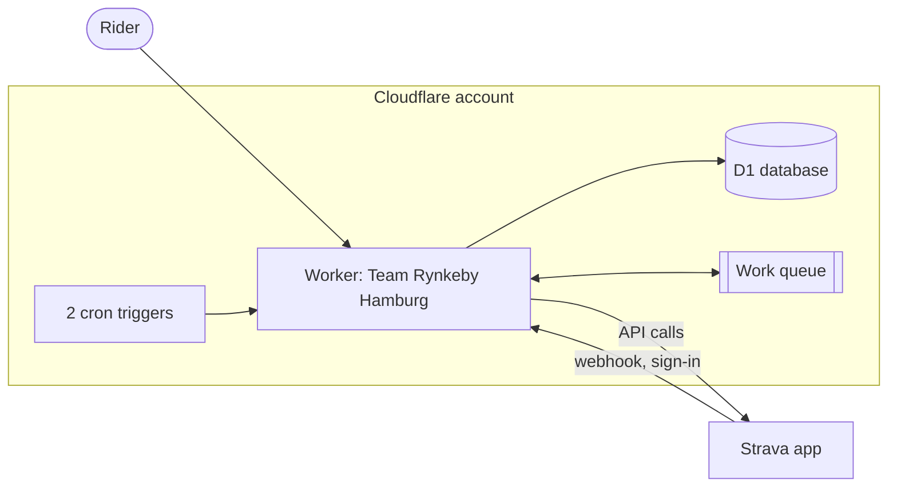

### Target (specced)

Each team gets its own Worker, database, queue, schedule, secrets and domain. A gateway receives
Strava's webhook events and sign-in returns, because Strava allows only one subscription and one
callback domain per app. Each team also gets a sandbox, which never talks to the real Strava.

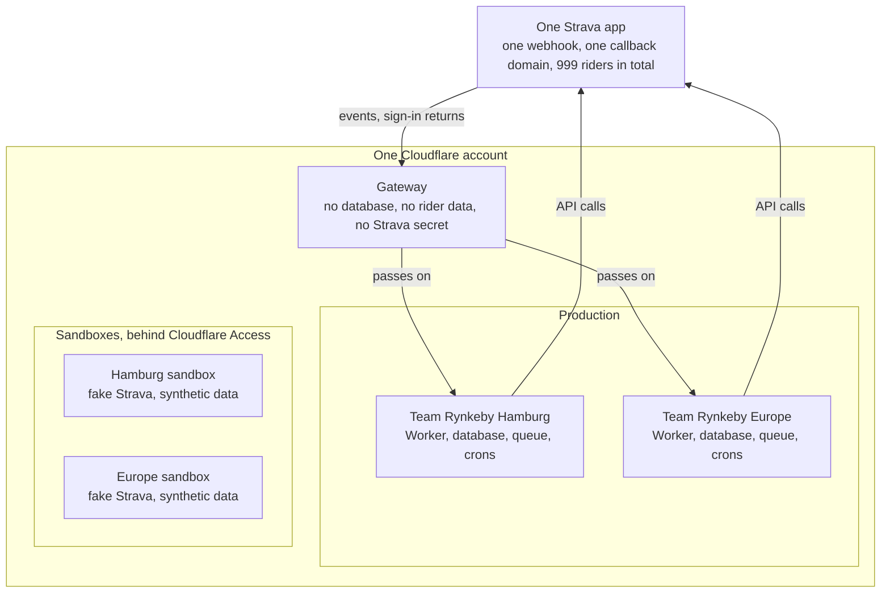

The missing arrows matter:

- No line connects the two teams, because no rider's data may be readable from another team's
  deployment. The only thing teams exchange is usage figures without rider data.
- No line connects a sandbox to production or to the real Strava. Production data never reaches a
  sandbox, not even anonymised.

Teams and the gateway all use the same Cloudflare allowances and the same Strava limits. Separate
accounts stay possible later, but aren't built. See [Spec 026](../specs/026-second-team/spec.md).

### A Strava event through the gateway (specced)

The gateway answers Strava within 2 seconds and passes each event to every team, retrying each team
on its own. A team that doesn't know the rider drops the event without a Strava request and without
storing or logging the IDs.

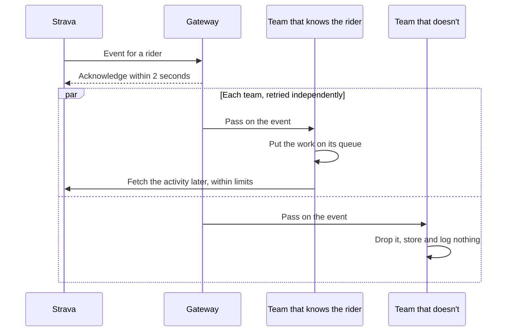

If one team can't be reached, the other isn't held up, and the missed events arrive later. Repeats
don't double-count.

### Connecting with Strava through the gateway (specced)

A rider starts and ends on their own team's domain. The gateway passes them on only to a fixed list
of team domains, and the team checks the sign-in as it does today.

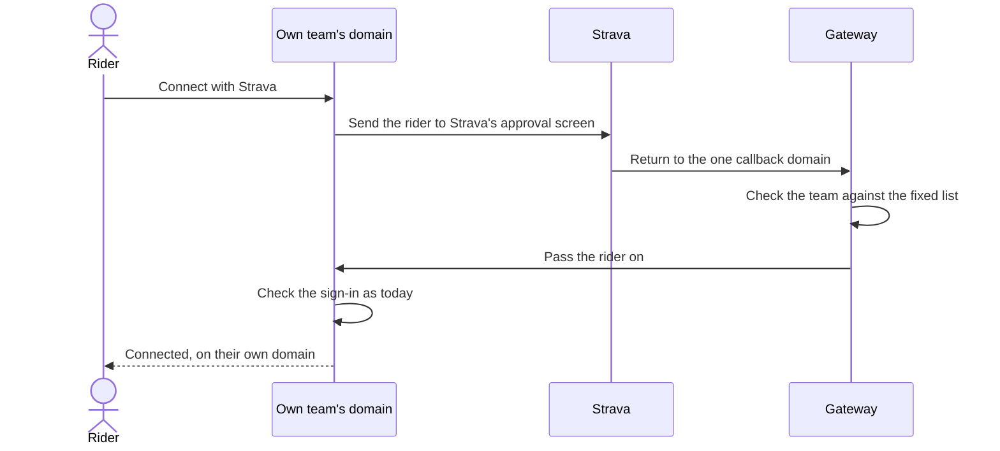

A rider can take part in only one team at a time. Strava's grant covers the app and not a team, so
connecting to both would break the connection, and the app says so when they connect.

## How a change reaches production

### Today

1. Cut a branch from `develop` and open a pull request into `develop`.
2. Required checks run: `lint`, `typecheck`, `test`, `e2e`, `commit-messages`, `pr-title` and
   `pr-source`. The branch must be up to date with `develop`.
3. Merge it. No approval is required.
4. Run the **Release PR** workflow, which opens a pull request from `develop` into `main`.
5. Merge the release with a merge commit. CI then applies database migrations and deploys the code.

### Target (specced)

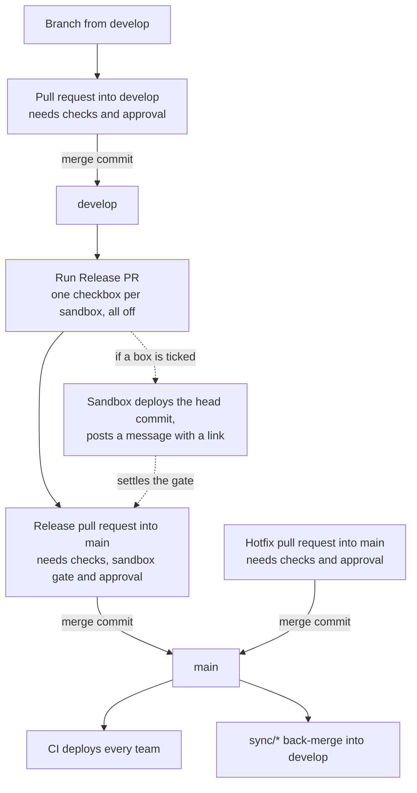

What changes compared to today:

- **Merge commits only.** Squash merging is forbidden, and rebase merging stays off. Every branch
  commit stays in the history, so each must keep passing `commit-messages`. The release pull
  request lists one line per merged pull request, by its title. This doesn't depend on the move to
  an organization and can ship first.
- **Approval.** See [Working together](#working-together).
- **Checkboxes and the gate.** See [Sandboxes](#sandboxes).

### How production deploys

A merge into `main` is the deliberate act that releases a change. Today this deploys one Worker. With
two teams, each deploys on its own: one team's failure neither stops nor rolls back the other, and a
failed team can be re-run alone.

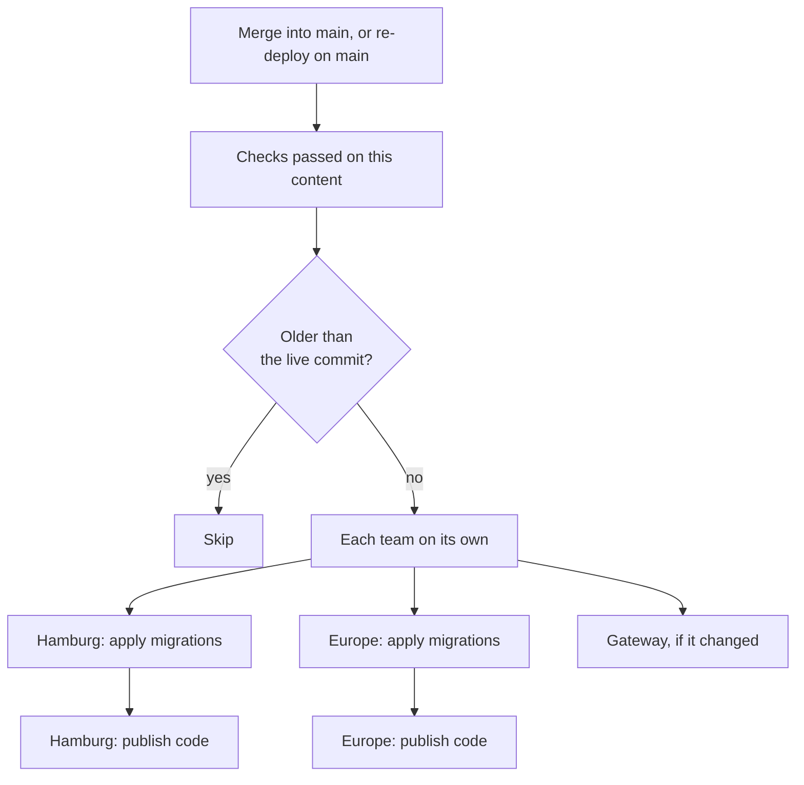

The per-team split and the gateway are specced. The rest of this runs today for the one Worker.

Some rules hold throughout:

- Migrations run before the code and only go forward, so a migration must keep the previous version
  working.
- The deploy credential is released only to `main`. Spec 028 wants credentials owned by the account or
  organization, not by a person.
- Gateway and team versions must work together in any order.
- Changing production secrets, creating or deleting resources, and changing the Strava subscription
  are manual steps, never a side effect.

## Sandboxes

> [!NOTE]
> Everything in this section is specced in [Spec 027](../specs/027-sandbox-deployment/spec.md) and
> not built. It depends on ❓ several items that planning has to try.

A sandbox lets a maintainer try a release before it reaches production. It runs fake mode, which means
a fake Strava and synthetic riders, so it can't show anything that needs the real Strava, such as
sign-in, real webhooks or rate limits.

Sandboxes are off by default, with one checkbox per sandbox on **Release PR**. The form says when one
can be skipped:

| | When |
|---|---|
| **Can be skipped** | Only docs, specs, tests, CI or developer tooling changed, or the change was already seen working |
| **Worth deploying** | Migrations; anything visible to riders; queue, webhook, cron or rule changes; team settings or data; a large release; or when unsure |
| **Which sandbox** | The team that changed, or any one for changes shared by all teams |

### The sandbox gate

The gate decides for one commit, the current head of the release pull request. When a new commit
arrives, an earlier decision stops counting. Everything can be done in the pull request, with one click
in a comment the workflow keeps up to date.

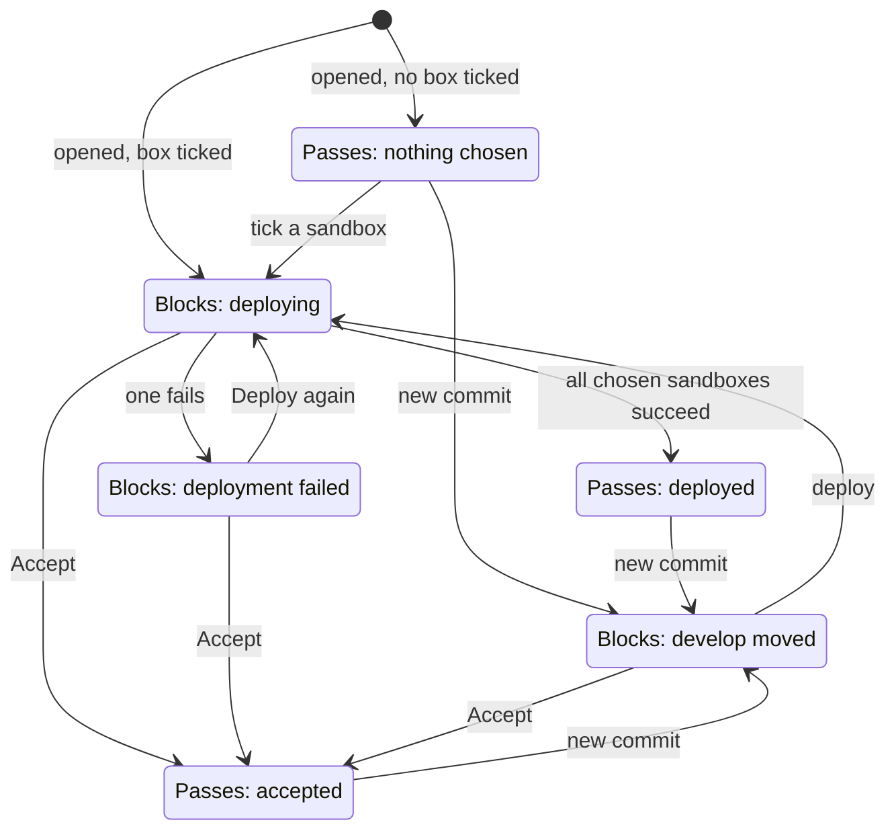

- A release can merge from any of the three **Passes** states.
- A **new commit** moves any state to **develop moved**. A deployment already running finishes for its own
  commit, and its message says that commit is no longer the head.
- A **hotfix** into `main` passes the gate at once, and never waits for a sandbox.
- **Nothing redeploys by itself.** When `develop` moves, someone decides.
- **Any maintainer can deploy.** At stage 1, only the founding maintainer can **Accept**.
- **The gate and approval are separate.** A release pull request needs both, for the same commit, and a
  new commit resets both.
- **Production's deployment doesn't depend on any sandbox.** The gate acts only on merging.

### Staying on the free plan

Sandboxes share the production account, so they share its limits. Running out of database allowance
stops production's database until 00:00 UTC. The figures below are from spec 027.

| Free plan limit | Amount |
|---|---|
| Cron triggers, per account | 5 |
| Databases, per account | 10 |
| Rows written, per day | 100,000 |
| Rows read, per day | 5 million |
| Queue operations, per day | 10,000 |
| CPU, per request | 10 ms |

So the sandboxes are held to a budget:

- They use no cron triggers. Scheduled work runs on demand from `/_dev/`.
- Nothing is used unless someone chooses a sandbox.
- Seeding writes at most 20,000 rows per day across all sandboxes, by default, and continues on the
  next run.

Before writing, every deployment and seeding stage checks the account's use:

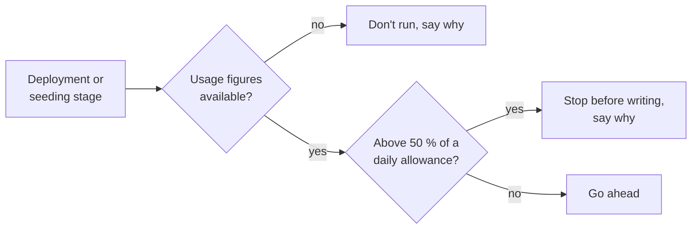

For the gate, a deployment stopped by this check counts as failed, and **Accept** can still clear it.

Each team uses 2 of the 5 cron triggers, so two teams fit, and a third wouldn't without fewer triggers per
team or the Paid plan. That's a known limit, not something to solve for the second team.

Moving to the Paid plan, from $5 per month, is a separate decision for later. It should need only
settings changed, not a new design.

## Working together

> [!NOTE]
> The stages are specced in [Spec 028](../specs/028-multiple-maintainers/spec.md). Today there's one
> maintainer, no organization and no approval rule.

### The stages

The founding maintainer approves everything at first, and this is how trust gets built. Stage 1 starts
when the repository is in the organization. Release pull requests opened by a GitHub App count as nobody's
own, so at stage 1 the founding maintainer approves those too. Failed deployments and usage alerts reach
every maintainer at every stage. There's no
date or automatic trigger for stage 2: the founding maintainer decides when.

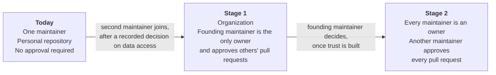

How a pull request gets approved at each stage:

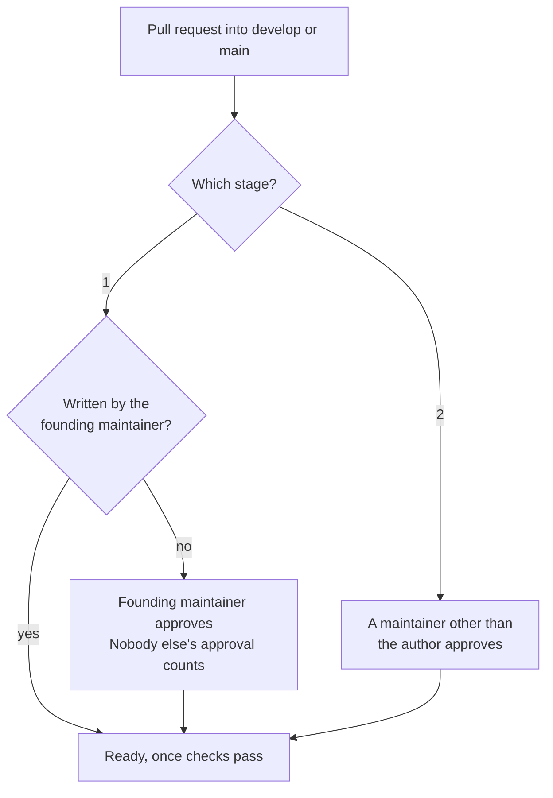

Some details apply at stage 1:

- The rule covers hotfixes, release pull requests and Dependabot's.
- A new push needs a new approval.
- GitHub doesn't let authors approve their own pull requests, so the founding maintainer gets an
  exemption, which goes away at stage 2. ❓ How exactly is still to be tried.

### Who may do what

| | Stage 1: second maintainer | Stage 1: founding maintainer | Stage 2: every maintainer |
|---|---|---|---|
| Open pull requests, run **Release PR**, re-deploy | ✓ | ✓ | ✓ |
| Merge a pull request once it's approved | ✓ | ✓ | ✓ |
| Change code, including code handling the Strava secret | ✓ | ✓ | ✓ |
| Deploy to a sandbox | ✓ | ✓ | ✓ |
| Administer the Cloudflare account, set other production secrets | ✓ | ✓ | ✓ |
| Approve pull requests | | ✓ | ✓ (not their own) |
| Merge their own pull requests with no approval | | ✓ | |
| **Accept** on the sandbox gate | | ✓ | ✓ |
| Own the organization, administer the repository, rulesets and environments | | ✓ | ✓ |

These stay with the Strava owner at every stage:

- Knowing the Strava secret's value.
- Setting or rotating the Strava secret, including for a new team's Worker.
- Acting on the Strava app: its settings, the Developer Program, contact with Strava, and moving the
  webhook subscription.
- Running the app locally against the real Strava with `pnpm dev:strava`. Everyone else uses fake mode,
  which covers normal development.

Maintainer rights don't depend on which team someone comes from. Being a maintainer also shows nothing
extra inside the app, because that's what the app admin role is for.

### The Strava secret and the accepted limit

Nobody else is ever given the Strava secret, and it's never in the repository, CI configuration or a
shared document. Cloudflare doesn't show it after it's set, and no routine task needs its value.

The running Worker does hold it, though. Anyone who can deploy production code could technically read it
by changing the code, and the same goes for riders' tokens and data. The Strava owner accepts this. It
rests on trust in the people made maintainers and on the visible history of what was merged, and the
project writes the limit down rather than engineering around it.

### Rider data

Production access reaches real rider data. So before anyone new gets it, the data controller records a
decision on who gets access and on what basis. Each affected team's controller does so. The review also
checks whether riders must be told more, in which case the privacy page or consent text changes first.
❓ It also has to confirm that Strava's API Agreement allows this.

The season album stays with the data controller, because the privacy page says albums are made on that
person's computer.

### When someone is away

If the founding maintainer is unreachable at stage 1:

| Keeps working | Waits for them | Allowed as a last resort |
|---|---|---|
| The app, on the secret already set | Merges, releases and hotfixes | Rolling back to an earlier version in Cloudflare, if production is broken |
| Re-deploying the current `main` | Rotating the Strava secret | Taking the Worker down, if production is broken or the secret may have leaked |
| Deploying to a sandbox | Setting up a new team's Worker | |
| | Anything at Strava | |
| | Every GitHub setting | |

A last-resort step is recorded with its reason. Cloudflare access makes it possible, and also lets a
maintainer publish code directly around the approval rule. That rests on trust, like the accepted limit.

Stage 1 has one more risk: the founding maintainer is the organization's only owner. If they lose their
GitHub account, their recovery codes are the safeguard. This risk is accepted until stage 2.

At stage 2 with only two maintainers, one person alone can't merge, even a hotfix, unless an owner changes
the rule.

### The Strava app's future

The Strava app is associated with the founding maintainer's personal Strava account. They intend to
support it for a prolonged period. If needed, a controlled move to someone else controlling the app gets
planned at that point. Nothing further is planned now.

## Moving to an organization and trying a merge queue

Moving the repository to an organization is what makes a second owner possible at stage 2. It also makes
a merge queue available, according to GitHub's docs. Issues, pull requests, secrets and webhooks move with
the repository, and old links redirect. ❓ GitHub's transfer page doesn't mention rulesets and environments,
so those get checked afterwards and re-applied from the repository's records if needed.

The original goal behind all this was simple: approve a pull request and have GitHub do the rest. Today the
up-to-date rule on `develop` stops that, because GitHub doesn't update a branch for auto-merge. Two ways out
are specced, and a trial decides between them:

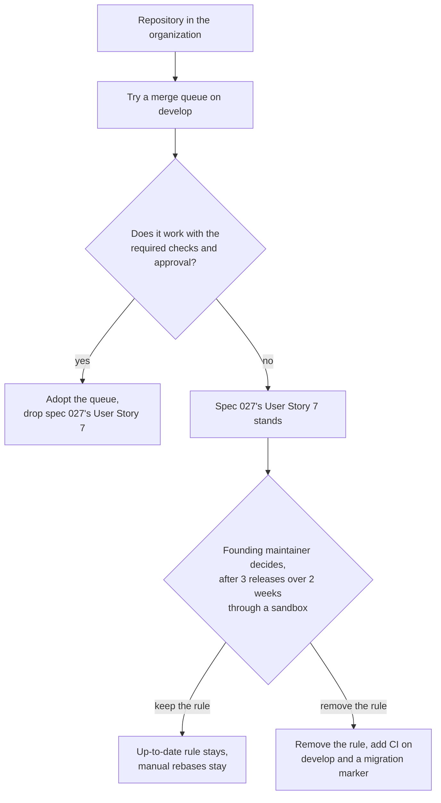

A queue tests each pull request against its exact target with no manual rebase. Removing the rule gives that
test up, so CI on `develop` and a migration marker catch clashes instead. Until one of these happens, the
up-to-date rule stays on.

## Suggested order

The specs state only parts of this order. The rest follows from what depends on what, and planning may
change it.

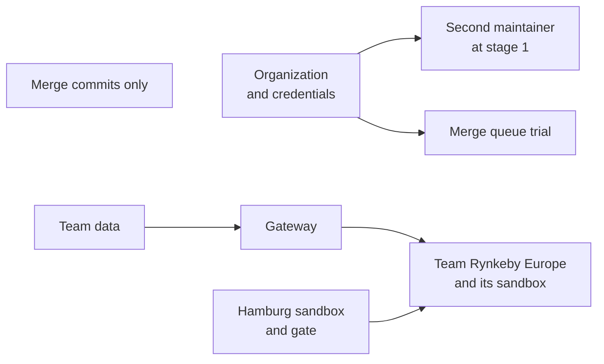

## Open questions

### Legal and Strava

- [ ] **Block list (025)**: the data controller confirms the legal basis for keeping a removed rider's
  Strava ID on the block list. The spec asks for this before launch, and that code has been released.
- [ ] **Strava API Agreement (028)**: does it allow another person to help run the app with access to its
  data? If it doesn't, spec 028 stops at access that doesn't reach rider data.
- [ ] **Data processing agreement (026)**: does a second team's controller need one with the people
  operating the system?
- [ ] **Telling Strava (026)**: should Strava be told about a second team, and do new pages need another
  review?
- [ ] **Consent (028)**: does a maintainer's access count as "newly shown to someone other than the rider"
  under the constitution's Principle I? If it does, a new consent version comes first.

### To confirm in planning

**GitHub**

- [ ] What the transfer does to rulesets, environments and the required checks' GitHub Actions pin.
- [ ] Whether a free organization covers everything used today, including the merge queue.
- [ ] How the founding maintainer's own pull requests get exempted: a separate ruleset with a bypass, or a
  required check. It has to work with auto-merge.
- [ ] Whether GitHub's Write role can change environment secrets. If it can, the stage 1 role needs
  narrowing.
- [ ] Which credential replaces the personal `RELEASE_PR_TOKEN`, most likely a GitHub App owned by the
  organization.
- [ ] How the merge queue handles `commit-messages`, `pr-title` and `pr-source`, which run on pull requests
  only today.

**Cloudflare**

- [ ] Whether the Free plan allows a second member, and which roles.
- [ ] Whether account-owned tokens are available on the Free plan.
- [ ] Whether per-Worker credentials work on the Free plan for a deployment with a queue consumer and assets.
  A narrow credential could probably still bind production's database, so the plan has to state what it
  can reach.
- [ ] Whether Cloudflare Access can protect a sandbox on a subdomain of the production domain on the Free plan.

**Sandboxes**

- [ ] Whether ticking a box in a comment reliably reaches a workflow. The fallback is a short command as a
  comment.
- [ ] How to report the gate so the ruleset's GitHub Actions pin accepts it.

### Before implementation

- [ ] The constitution needs amending: for more than one maintainer and the accepted limit (028), and for
  per-team default languages (026).
- [ ] Team Rynkeby Europe provides its domain, Strava clubs, Rynke values, dates, languages, switchable
  features, controller and contact, art direction, a phrase brief, a rater and native-speaker reviewers.
