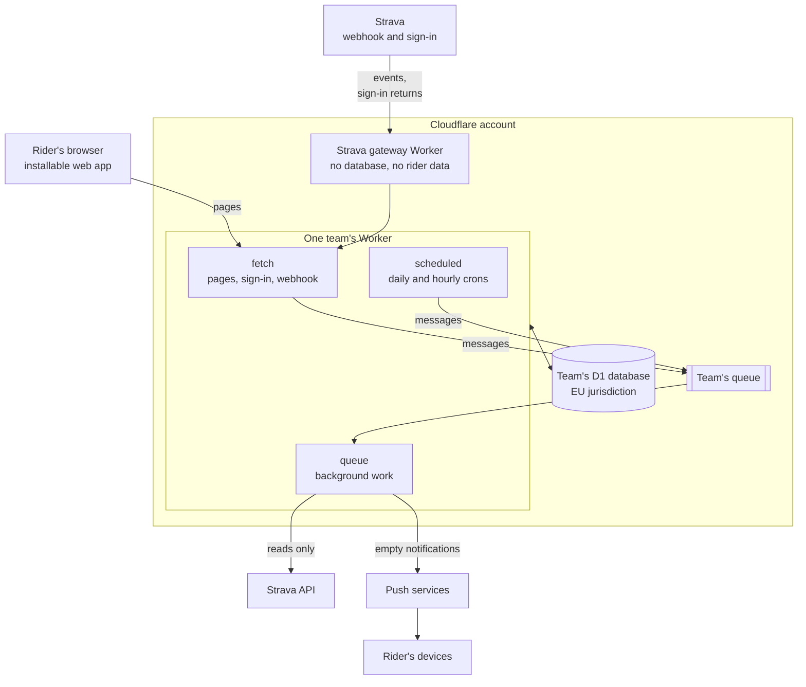
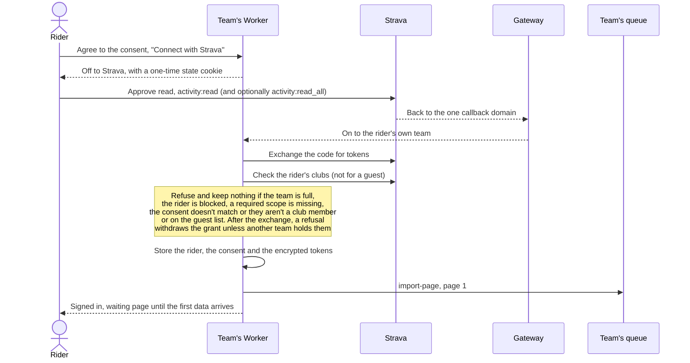
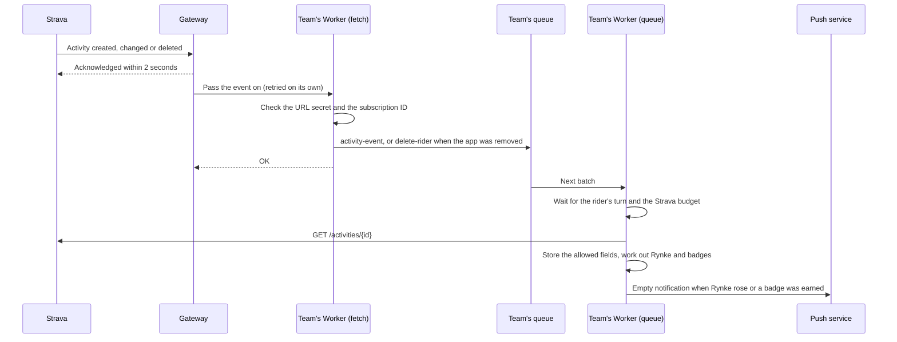
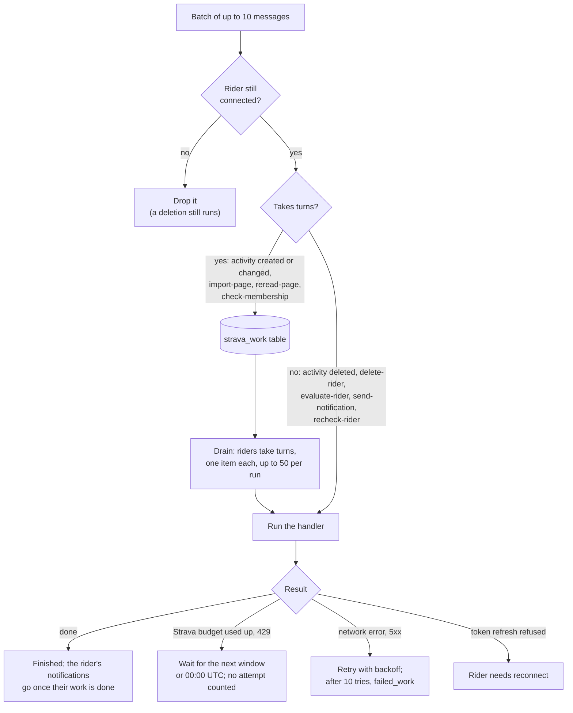
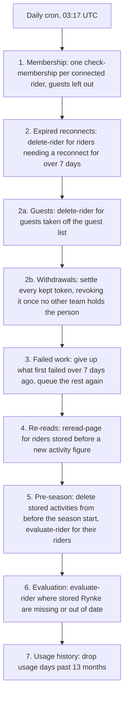
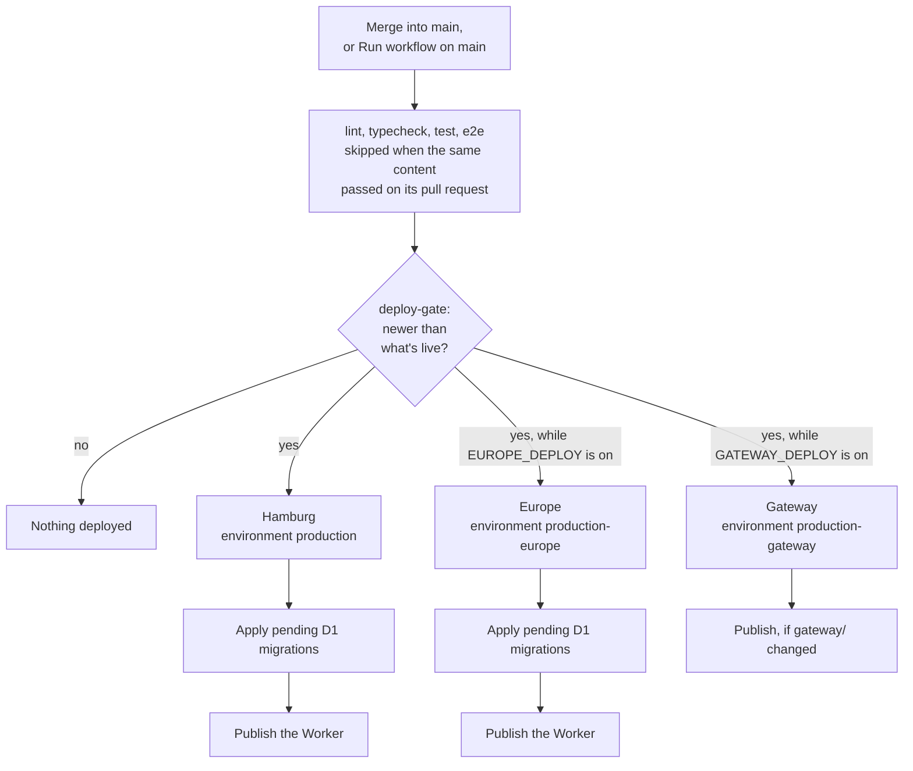

# How RynkePoints runs

This page covers what RynkePoints is made of and why, how it talks to Strava, how it runs on
Cloudflare, which jobs run when and what they do, the usage limits it has to stay within, and how
it's deployed. How several teams and maintainers work together is in
[Architecture and working together](architecture-and-collaboration.md). The specs are the source of
truth: if this page disagrees with one, the spec wins.

## The parts

Every team runs the same code as its own deployment. Each deployment is a Cloudflare Worker with its
own D1 database, queue, two cron triggers, secrets and domain. No rider data is shared between teams.
A small gateway Worker sits between Strava and the teams, because Strava allows only one webhook
subscription and one sign-in return domain per application.



### Tech stack

| Area | Choice | Why |
|---|---|---|
| Runtime | [Cloudflare Workers](https://developers.cloudflare.com/workers/), one per team plus the gateway | Serverless on the free plan, with no server to patch |
| Storage | [D1](https://developers.cloudflare.com/d1/) (SQLite), one database per team in the EU jurisdiction; forward-only migrations in `migrations/` | Rider data stays in the EU and within its own team |
| Background work | [Queues](https://developers.cloudflare.com/queues/) and two [cron triggers](https://developers.cloudflare.com/workers/configuration/cron-triggers/) per team | Webhooks are acknowledged fast and the work is queued; the processing is idempotent |
| Pages | HTML rendered in the Worker, static assets from `public/`, an installable PWA with Web Push | No front-end framework to keep up to date |
| Language | TypeScript, with few dependencies: Chart.js for charts, pdf-lib and mp4-muxer for shared badges and the season album | A small bundle and little upkeep |
| Strava | One [Strava API](https://developers.strava.com/docs/) application for every team, read only; its webhook and sign-in run through the gateway | Strava allows one subscription and one callback domain per application |
| Teams | `src/teams/<id>.ts` plus the team's `env` block in `wrangler.jsonc`, checked by `scripts/team-check.mjs` | Adding a team means adding data, not code |
| Local development | `pnpm dev`: every team at once against a fake Strava with synthetic riders | Nobody needs real Strava access or real data |
| Tests | Vitest inside the Workers runtime; Playwright in Chromium, Firefox and WebKit | Test-first is a project principle |
| Code quality | Biome (lint and format), `tsc`, Conventional Commits through commitlint and lefthook | The same checks run locally and in CI |
| Specs | [Spec Kit](https://github.com/github/spec-kit): a spec, plan and tasks for each feature under `specs/` | Every decision is written down, and the spec wins |
| Delivery | GitHub Actions: pull requests into `develop`, a release pull request into `main`, then CI deploys each team | Nobody deploys production by hand |
| Sandboxes | Each team's app in fake mode, behind Cloudflare Access ([sandboxes.md](sandboxes.md)) | A release can be tried before it goes live |

## On Cloudflare

### A team's Worker

`src/index.ts` exports three entry points. Each one builds the same context (the team's bindings,
team data, catalogs and clock) and hands it to the code that does the work:

| Entry point | Started by | What it does |
|---|---|---|
| `fetch` | Each HTTP request: pages, sign-in, the webhook, the page's own calls | Renders pages from D1, runs sign-in, and puts webhook events on the queue |
| `queue` | A batch of up to 10 messages from the team's queue, one batch at a time | Everything slow, and every Strava call: imports, activity events, membership checks, deletion, Rynke evaluation, notifications |
| `scheduled` | The two cron triggers | The [daily job and the hourly job](#background-jobs) |

The `fetch` handler never waits for Strava except during sign-in, where a person is waiting. Anything
that can be done later goes on the queue.

### Resources per team

Each team's block in `wrangler.jsonc` declares these. Every Wrangler command names the team with
`--env hamburg` or `--env europe`, and a command without one fails on purpose.

| Resource | Hamburg's | Notes |
|---|---|---|
| Worker | `rynke-points` | Serves the team's custom domain. `workers.dev` and preview URLs are off. |
| D1 database | `rynke-points` | Created with `--jurisdiction=eu`, which can't be added later. Cloudflare keeps 7 days of point-in-time backups (Time Travel). |
| Queue | `rynke-points-work` | Consumed by the same Worker: batches of 10, one batch at a time, up to 10 retries. |
| Cron triggers | `17 3 * * *`, `58 * * * *` | In UTC: daily at 03:17, and hourly at minute 58. |
| Static assets | `public/` | Icons, art, the rules handout PDFs and Strava's brand assets, served without running the Worker. |
| Secrets | see [Secrets](#secrets) | Set with `wrangler secret put`, never in the repository. |
| Logs | Workers observability | The app's own log lines, which hold identifiers only. Invocation logs are off, because they would record the webhook's secret URL. |

### The gateway

`gateway/` is a Worker of its own, with no database and no rider data. It receives Strava's webhook
events and passes each one to every team through its own queue, retrying each team separately (up to
100 times), so a team that is down doesn't hold up the others. It also sends a rider coming back from
Strava's sign-in on to their own team's domain, and only to domains on its fixed list. It reaches
Hamburg through a service binding. The sequence diagrams are in
[Architecture and working together](architecture-and-collaboration.md#a-strava-event-through-the-gateway),
and the move behind it is in [gateway-switch.md](gateway-switch.md).

## Strava

All teams share one Strava API application, and it only reads. The app never writes to Strava, so it
never requests `activity:write`, and the client in `src/strava/` has no write call.

### Connecting

A rider first agrees to the consent text on the landing page. Only then does the app send them to
Strava's approval screen.



The tokens are encrypted with AES-256-GCM (`TOKEN_ENCRYPTION_KEY`) before they're stored. An access
token lasts about six hours, and the app refreshes it with the refresh token when it needs one. If
Strava refuses the refresh, the rider is marked *needs reconnect*. If they don't reconnect within 7
days, everything about them is deleted.

### Webhook events

Strava sends an event when a rider creates, changes or deletes an activity, and when they remove the
app in their Strava settings. An event holds identifiers only, never the activity itself.



The webhook route never calls Strava itself. A team that doesn't know the rider drops the event
without storing or logging it. Strava sends no event when a ride is only cropped, which is what the
[ride edit re-check](#hourly-job-minute-58) is for.

### What the app reads

| Purpose | Request |
|---|---|
| Sign-in, token refresh, revoke | `POST /oauth/token`, `POST /oauth/revoke` |
| Club membership | `GET /athlete/clubs` |
| One activity | `GET /activities/{id}` |
| The season import, re-reads and the ride edit re-check | `GET /athlete/activities?after=…&per_page=200` |

The full list, and the fields read from each response, are in
[contracts/strava-api-usage.md](../specs/001-strava-connect-webhook/contracts/strava-api-usage.md). Only
the allowed fields are stored, as listed in the README's [Privacy](../README.md#privacy) section.

### Staying within Strava's limits

Strava counts requests for the whole application, so all teams share one budget (the figures are under
[Usage limits](#usage-limits)). The [fair Strava budget](../specs/024-fair-strava-budget/spec.md) keeps
the app within that budget:

- **It knows its use.** Every Strava response carries the application's usage in its headers, and the
  app stores the latest figures, so each team also sees what the other teams used.
- **It holds back a reserve.** Background work stops 20 requests short of each 15-minute limit and 100
  short of each daily limit. Sign-in, reconnecting and revoking may use that reserve, because a person
  is waiting for them.
- **It defers.** When the budget is used up, or Strava answers `429`, the message waits until the next
  15-minute window or 00:00 UTC. This doesn't count as a failed attempt.
- **Riders take turns.** Messages that need Strava go into a work table (`strava_work`). Riders take
  turns, one item each, so a new rider importing a whole season doesn't hold up everyone else's new
  rides. A rider's notifications wait until their own work is done.

## Background jobs

Background work runs as messages on the team's queue. Webhook events, sign-ins, organisers' input
and the two cron jobs send them. Each message holds identifiers only, and is safe to handle twice:
it moves towards Strava's current state instead of adding to it.

### The messages

| Message | Started by | What it does | Strava requests |
|---|---|---|---|
| `activity-event` | A webhook event | Fetches the activity and stores its allowed fields. It deletes the activity instead if it's gone, private without the rider's consent, or a kind the app doesn't keep. Then works out Rynke and badges again. | 1 (none for a delete) |
| `import-page` | Connecting, reconnecting, or newly allowing private activities | Reads 200 of the rider's activities since the season start, stores the rides, runs and swims, and queues the next page until the last one. | 1 per page |
| `reread-page` | The daily job, once per rider after a new activity figure was added | The same as `import-page`. | 1 per page |
| `check-membership` | The daily job | Checks the rider is still in the team's Strava club, and queues `delete-rider` if not. | 1 |
| `delete-rider` | The app removed in Strava, leaving the club, no reconnect within 7 days, or a guest taken off the guest list | Withdraws the rider's Strava access unless another team holds them (asked through the gateway), then deletes everything about them. Always finishes; a withdrawal that can't settle yet stays in `pending_revocations` for the daily run. | 0 or 1 |
| `evaluate-rider` | Organisers' attendance and corrections, and the daily job | Works out the rider's Rynke and badges from what's stored. | 0 |
| `send-notification` | Rynke that rose, a badge earned, a usage alert | Sends an empty Web Push message to each of the rider's devices. The device then fetches the text. | 0 |
| `recheck-rider` | The hourly job | Reads the rider's newest 200 activities and passes only the differences to the usual processing. Never retried. | 1 |

### How the queue handles a message



When something fails:

- **A network error or a Strava `5xx`** is retried after 30 seconds, then after twice as long each
  time, for up to an hour between tries and 10 attempts. After that the message is saved in
  `failed_work`, and the daily job tries it again for up to 7 days.
- **A used-up budget or a `429`** defers the message (see
  [Staying within Strava's limits](#staying-within-stravas-limits)).
- **A refused token refresh** marks the rider *needs reconnect*. Their messages are then dropped,
  except deletion.

The full rules are in
[contracts/queue-messages.md](../specs/001-strava-connect-webhook/contracts/queue-messages.md), as
amended by the [fair Strava budget](../specs/024-fair-strava-budget/contracts/queue-messages.md).

### Daily job (03:17 UTC)

These steps are independent: a failing step doesn't skip the others, but the run still fails so it
shows in the logs.



### Hourly job (minute 58)

1. **Usage**: records the day's Strava and Cloudflare figures for the
   [admin view](../specs/025-admin-usage-view/spec.md). These are Strava's latest usage headers,
   Cloudflare's analytics for the account (if its token is set) and other teams' counts. It notifies
   administrators who turned alerts on, once a figure reaches 80 % and again at 95 %. Nothing in this
   step calls Strava.
2. **Ride edit re-check** ([spec](../specs/036-ride-edit-recheck/spec.md)): picks a few riders who
   had an activity in the last 30 days and sends one `recheck-rider` for each, spread over the next 55
   minutes. Riders who waited longest go first. All teams together use at most 300 reads a day for
   this. A run sends nothing while more than half of the day's reads are used.

### By hand

| Command | Does |
|---|---|
| `pnpm daily:run` | Runs the daily job now ([manual daily run](../specs/007-manual-daily-run/spec.md)). Needs `ADMIN_TOKEN`. |
| `pnpm catch-up <since>` | Re-reads every rider's activities since a moment, for example after moving the webhook. Needs `ADMIN_TOKEN`. |
| `pnpm season:album` | Builds the season album PDFs on the maintainer's computer. It reads production and writes nothing back. |

In fake mode and the sandboxes, which have no cron triggers, `/_dev/` runs the scheduled jobs on
demand.

## Usage limits

All teams, the gateway and the sandboxes share one Strava application and one Cloudflare account. The
limits below are for all of them together. The [admin view](../specs/025-admin-usage-view/spec.md)
(`/admin`) shows each one as used today, keeps 13 months of history, and alerts at 80 % and 95 %. The
figures it checks against are in `src/usage/allowances.ts`.

### Strava

| Limit | Amount | When it's reached |
|---|---|---|
| Read requests | 300 per 15 minutes, 3,000 per day | Background work waits for the next window or day; sign-in keeps a small reserve |
| All requests | 600 per 15 minutes, 6,000 per day | The same |
| Connected athletes | 999 for the application | New riders see "team full" when they connect |

The 15-minute windows start at :00, :15, :30 and :45, and days start at 00:00 UTC. These are the limits
Strava granted after its Developer Program review
([strava-developer-program.md](strava-developer-program.md)). The app reads the current limits from
each response, so it picks up a change by itself.

Roughly what uses the reads:

| Event | Reads |
|---|---|
| A rider connects | 1 club check, plus 1 per 200 activities since the season start |
| A ride is added or changed | 1 |
| A ride is deleted | 0 |
| Each connected rider, each day | 1 membership check |
| The ride edit re-check | at most 300 a day, for all teams |

### Cloudflare

The account is on the Workers free plan. Daily limits reset at 00:00 UTC.

| Limit | Amount | When it's reached |
|---|---|---|
| Worker requests | 100,000 per day | Requests fail until 00:00 UTC. Static assets don't count. |
| Queue operations | 10,000 per day | Sending, delivering and acknowledging a message each count, so a message costs about three. |
| D1 rows read | 5 million per day | Every query fails until 00:00 UTC, so the app stops working. |
| D1 rows written | 100,000 per day | The same. |
| D1 storage | 5 GB | Writes fail. |
| CPU time | 10 ms per invocation | That invocation fails. Pages stay small, and heavy work is split into queue messages. |
| Subrequests | 50 per invocation to other services, 1,000 to Cloudflare's | Strava, the gateway and push services count against the 50; D1 and the queue against the 1,000. Past either, the call fails, so batches and fan-outs stay small: the drain stops after 15 items. |
| Cron triggers | 5 per account | Each team uses 2, so a third team needs fewer triggers or the paid plan. |

The sandboxes have no cron triggers, and they stop before writing once any daily allowance is half
used ([sandboxes.md](sandboxes.md)). Moving to the Workers paid plan (from $5 a month) is a separate
decision. It would only change the figures in `src/usage/allowances.ts`, not the design.

## Deploying

Merging into `main` deploys. Merges into `develop` deploy nothing, and nobody deploys production by
hand.



Each team deploys on its own: if one team fails, the others still deploy, and the failed one can be run
again alone. The `EUROPE_DEPLOY` and `GATEWAY_DEPLOY` switches are repository variables
([repository settings](../.github/repository-settings.md)).

### Migrations

Migrations run before the new code is published, and only go forward: they're never rolled back. So for
a while, the previous version runs against the new schema. A migration must therefore keep the
previously deployed version working:

- Add tables and columns freely.
- To remove or rename something, first release code that no longer uses it. Drop it in a later
  release.

Before merging a release pull request, check every new file in `migrations/` against that rule.

### When something goes wrong

- **Which commit runs**: **Deployments → production** (Hamburg) or **production-europe** on GitHub. The
  Cloudflare version message carries the commit SHA as well.
- **A failed deploy** turns the run on the `main` commit red and marks the deployment *failure*. The
  maintainer gets an email, and the previous version keeps serving.
- **Re-deploy**: `gh workflow run ci.yml --ref main` (or **Actions → CI → Run workflow → `main`**). It
  runs the checks again and deploys the tip of `main` only.
- **Rollback**: preferably revert the change through a [hotfix](../README.md#hotfixes). As a last
  resort, `pnpm wrangler rollback <version-id> --env <team> --message "rollback: <reason>"` restores an
  earlier version at once, with limits: migrations stay applied, only the last 100 versions are
  available, GitHub doesn't see it, and the next merge or re-deploy publishes `main` again.
- **A local `pnpm run deploy <team>`** is a last resort too.

### Secrets

Each team's Worker needs these, set once per team with
`pnpm wrangler secret put <NAME> --env <team>`. Each command asks for the value. A deploy fails while a
required secret is missing.

| Secret | Purpose |
|---|---|
| `STRAVA_CLIENT_ID`, `STRAVA_CLIENT_SECRET` | The Strava application. Only its owner sets them. |
| `STRAVA_WEBHOOK_VERIFY_TOKEN` | The webhook URL's secret, and Strava's subscription handshake |
| `TOKEN_ENCRYPTION_KEY` | Encrypts riders' Strava tokens |
| `SESSION_SIGNING_KEY` | Signs the sign-in cookie |
| `ADMIN_TOKEN` | For `pnpm daily:run` and `pnpm catch-up` |
| `PUSH_VAPID_KEY` | Signs notifications. Keep it: a new key ends every device's notifications until the riders turn them on again. |
| `CLOUDFLARE_ANALYTICS_TOKEN`, `CLOUDFLARE_ANALYTICS_ACCOUNT_ID` | Optional: Cloudflare's figures in the admin view |
| `USAGE_EXCHANGE_TOKEN` | Optional: the same value in every team, to show every team's share of the shared limits |

To create the push key:

```bash
node -e 'crypto.subtle.generateKey({name:"ECDSA",namedCurve:"P-256"},true,["sign"]).then(k=>crypto.subtle.exportKey("jwk",k.privateKey)).then(({kty,crv,x,y,d})=>console.log(JSON.stringify({kty,crv,x,y,d})))' \
  | pnpm wrangler secret put PUSH_VAPID_KEY --env hamburg
```

For Cloudflare's figures in the admin view, create a token in the Cloudflare dashboard under *My
Profile → API Tokens → Create Token → Create Custom Token*. Give it only *Account → Account Analytics →
Read*, for this account only. The account ID is in the output of `pnpm wrangler whoami`. Without the
token and the account ID, the view says the figures are unavailable and everything else works. To see the
figures at once, use *Update now* on `/admin`. If the figures still don't show,
`pnpm wrangler tail --env hamburg` during an update shows the reason.

Being an administrator, and lifting a block, are set directly in the database:

```bash
# Mark an administrator; `= 0` clears it, from the next request on.
pnpm wrangler d1 execute DB --remote --env hamburg \
  --command "UPDATE riders SET administrator = 1 WHERE athlete_id = <id>"
# Lift a block. The list holds no names, so this needs the rider's Strava ID.
pnpm wrangler d1 execute DB --remote --env hamburg \
  --command "DELETE FROM blocked_athletes WHERE athlete_id = <id>"
```

An administrator of one team can look at another team's site as a guest
([feature 041](../specs/041-admin-every-team/spec.md)). Each team has its own guest list of Strava IDs.
A person on it signs in through Strava without being in the team's club and is an organiser and an
administrator there. Their own rides show on their own pages, but they count in none of the team's
figures. Their Strava grant is never withdrawn while another team, normally their home team, holds
them: every team shares one Strava app, and a revoke ends the grant at every team. A team letting
someone go or turning them away asks the gateway whether another team holds them and withdraws the
grant only if none does ([contracts/withdrawal.md](../specs/041-admin-every-team/contracts/withdrawal.md)).

```bash
# Put someone on Europe's guest list; they can sign in from then on.
pnpm wrangler d1 execute DB --remote --env europe \
  --command "INSERT OR IGNORE INTO guests (athlete_id) VALUES (<id>)"
# Take them off: their next request is signed out, the next daily run deletes their data there.
pnpm wrangler d1 execute DB --remote --env europe \
  --command "DELETE FROM guests WHERE athlete_id = <id>"
# Who is listed, and who has signed in as a guest.
pnpm wrangler d1 execute DB --remote --env europe --command "SELECT athlete_id FROM guests"
pnpm wrangler d1 execute DB --remote --env europe \
  --command "SELECT athlete_id, first_name FROM riders WHERE guest = 1"
```

Only administrators of their home team belong on a guest list, and the teams don't see each other's
data, so keeping it that way is the maintainer's job: whoever clears someone's administrator flag at
home also takes their ID off every other team's guest list in the same sitting. A real Strava ID
goes only into these commands, never into the repository.

### One-time setup

- **A new team's resources, secrets and gateway entry**: [add-a-team.md](add-a-team.md).
- **The first production setup**, including the webhook subscription and Strava's brand assets:
  [feature quickstart §3](../specs/001-strava-connect-webhook/quickstart.md#3-first-production-setup-manual-maintainer-runs-each-step).
  Create the D1 database with `--jurisdiction=eu`, because it can't be added later.
- **The deploy credential, the GitHub environments and rotating the credential**:
  [CI quickstart §7–§11](../specs/002-ci-branch-protection/quickstart.md#7-deploy-setup-user-story-5-one-time).
