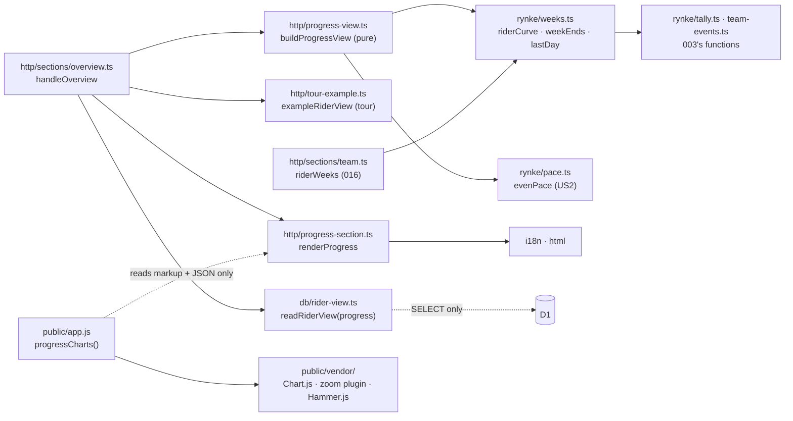
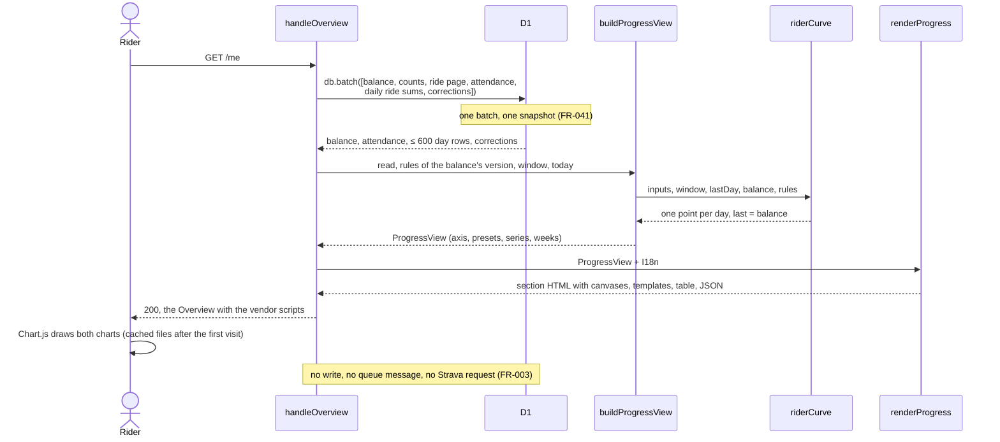
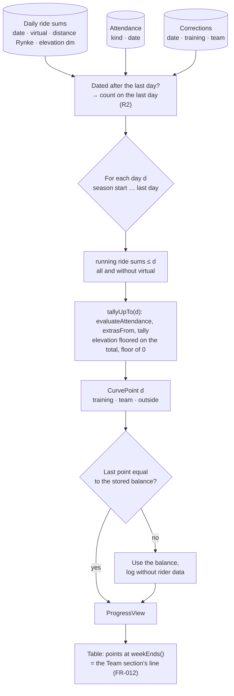
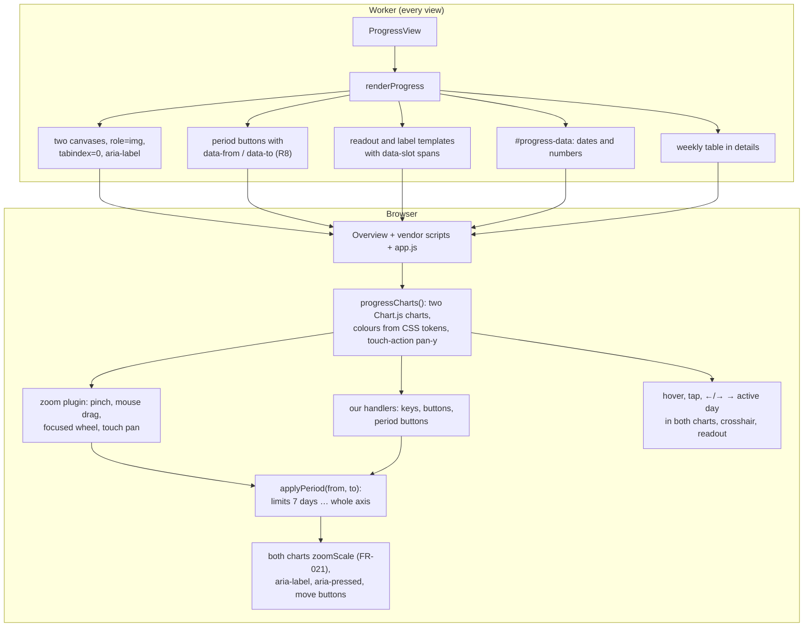
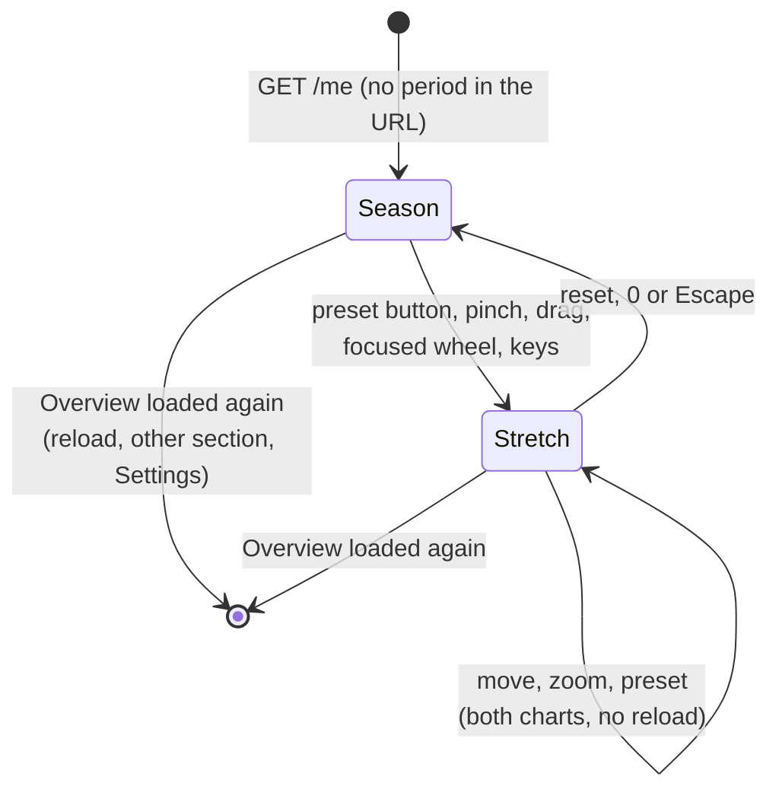
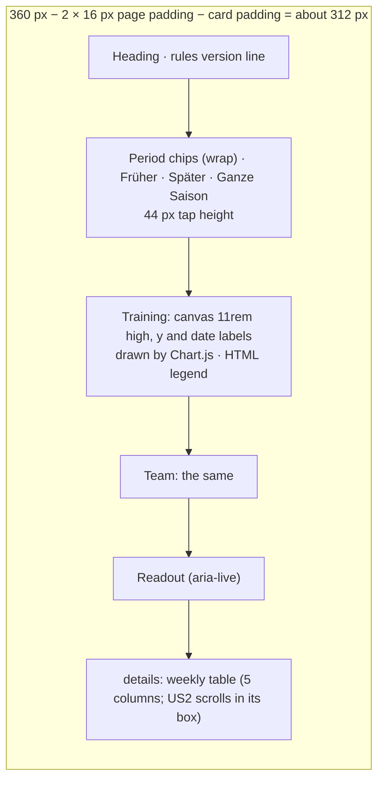

# Implementation Plan: Rider Progress Charts

**Branch**: `009-rider-progress-charts` (work on `docs/009-spec-refresh`) | **Date**:
2026-10-19 (re-planned; replaces the unbuilt plan of 2026-10-07) | **Spec**:
[spec.md](spec.md)

**Input**: Feature specification from `/specs/009-rider-progress-charts/spec.md`,
revised 2026-10-19

## Summary

The Overview ("Du") gets a progress section below the breakdown:
- two zoomable line charts of the rider's Training and Team Rynke over the season,
  each with its threshold line;
- a readout of the selected day;
- a weekly table as the text version.

US2 later adds the pace lines and the outdoor curve.

- **Curve**: rebuilt on every view by a new `riderCurve` in `src/rynke/weeks.ts`.
  It reuses that file's `tallyUpTo`, the same code behind 016's weekly line, so
  the table's week totals equal the Team section's (R1, R2).
  - Input: two SELECTs added to the Overview's existing batch (R3).
  - Nothing is stored and there is no migration.
- **Drawing and interaction: Chart.js** 4 with chartjs-plugin-zoom and Hammer.js
  (R4), justified under Principle IV. The app requires JavaScript (constitution
  v2.2.0), so the charts are drawn in the browser on two canvases, one x unit per
  day across the whole axis (R5).
  - The library files are vendored into `public/vendor/` from pinned
    devDependencies, without a build step, and loaded only on the Overview (R6).
  - The plugin gives pinch, mouse drag, wheel, pan, limits and reset.
    `progressCharts()` in `public/app.js` adds the keys, the buttons, one period
    for both charts, the crosshair, the readout and the colours from the CSS
    tokens (R7, R9, R12).
  - The server renders the section around the canvases: heading, period buttons,
    legends, readout templates from the catalogs, the weekly table and the chart
    JSON. `app.js` holds no text (R9).
- **Look**: a Material 3 outlined card across both grid columns. Curves use
  darker, validated steps of the brand colours, readable in light and dark mode
  (R12).
- **Pace (US2)**: 016's `evenPace`, so the charts agree with the rider status.

## Technical Context

**Language/Version**:
- TypeScript 7 (`tsc --noEmit`) on Cloudflare Workers.
- Browser: plain JS in `public/app.js`, as for 010–020, plus vendored Chart.js.

**Primary Dependencies**:
- New, browser only (devDependencies, vendored into `public/vendor/`, R4, R6):
  `chart.js` 4.5.1, `chartjs-plugin-zoom` 2.2.0, `hammerjs` 2.0.8, all MIT.
  Nothing new in the Worker bundle.
- Existing:
- the `html` template, `I18n` (`t`, `tHtml`, `formatDate`, `formatNumber`);
- `readRiderView`;
- `src/rynke/weeks.ts`, `pace.ts`, `tally.ts` and `team-events.ts`;
- `shellPage`.

**Storage**: D1, read only. Two SELECTs added to `readRiderView`'s batch when the
Overview asks for them ([data-model.md](data-model.md)). No migration.

**Testing**:
- Vitest in workerd (`pnpm test`) for the pure modules, the markup and `/me`.
- Playwright (`pnpm test:e2e`, Chromium, Firefox and WebKit) for the browser
  interaction (R13).

**Target Platform**: Cloudflare Workers. Server-rendered HTML with the deferred
`app.js` and, on the Overview, the deferred vendor scripts, on current evergreen
browsers with JavaScript (constitution v2.2.0).

**Project Type**: web service (one Worker with pages, webhook, queue and cron, plus
static assets).

**Performance Goals**:
- The Overview within 2 s at 500 rides (SC-005); the rebuild under 10 ms (R14).
- Zoom and select respond within 0.5 s on a mid-range phone, without animation.
- 82 KB gzip of vendor scripts on the first Overview visit, cached for a year
  after (versioned names).

**Constraints**:
- 320–360 px wide without sideways scrolling (FR-070).
- No Strava call and no write on view (FR-003).
- Only Rynke are shown (FR-005).
- Line charts only (FR-007).
- All text from the catalogs (FR-060).
- Light and dark mode (FR-072).

**Scale/Scope**:
- ≤ 10 riders, ≤ 500 rides each, a 303-day axis.
- About 10 source files touched, 3 new (`src/http/progress-view.ts`,
  `src/http/progress-section.ts`, `scripts/vendor.mjs`), plus 3 vendored files
  with their licences.
- 18 + 6 catalog keys.
- 3 new Vitest files, 1 new integration file, 1 new e2e file.

## Constitution Check

*GATE: Must pass before Phase 0 research. Re-checked after Phase 1 design
(below).*

| Principle | How this plan complies | Result |
|---|---|---|
| **I. Privacy and consent** | Nothing new is read from Strava and nothing new is stored. The rider sees only their own derived Rynke (FR-002), which their consent covers (spec Assumptions). The page data holds only dates and whole numbers of Rynke. The metre sums used to place elevation steps never leave the Worker (data-model.md). The script makes no request and keeps no storage or cookie. The library is served from the app's own origin, never a CDN, so no third party learns who opens the Overview (R6). Fixtures and e2e samples are synthetic. | Pass |
| **II. Strava API citizenship** | No Strava request on view, zoom or select (FR-003, SC-006). | Pass |
| **III. Rider-authored content wins** | Nothing is written. | Pass |
| **IV. Serverless, TS, minimal deps** | One new browser dependency, justified in R4: Chart.js with its zoom plugin (and Hammer.js, which the plugin needs) instead of hand-rolled gestures. Browser only, vendored without a build step, loaded only on the Overview (R6); the Worker bundle is unchanged. The curve reuses the pure rules functions through `weeks.ts` (R1), so the points stay recomputable from stored data. Two SELECTs, within the free tier. | Pass (justified) |
| **V. Test-first** | Every FR maps to a test written first ([quickstart.md](quickstart.md) §1). The browser part, untested in the first plan, now gets Playwright tests in three browsers (R13). | Pass |
| **Language** | 18 keys for US1 and 6 for US2, in `de` and `en`. `app.js` holds no text (R9). Code and docs are in English. | Pass |
| **Technology constraints (v2.2.0)** | JavaScript is required: no no-script version of the charts (spec FR-052 removed). The weekly table stays for screen readers (FR-050, FR-051). | Pass |
| **Brand / Strava API Agreement** | Line charts of Rynke only: no training analysis, rides or performance figures, so nothing that "replicates Strava functionality" (FR-005, FR-007). | Pass |
| **Development workflow** | Spec Kit order. US1 is one PR into `develop`, US2 a later one. No migration. | Pass |

**Post-design re-check (after Phase 1)**: still Pass.
- [data-model.md](data-model.md): two SELECTs, nothing stored. The chart JSON has
  no names, units or ride data.
- [contracts/overview-section.md](contracts/overview-section.md): the section is
  only on the Overview, only for the signed-in rider (or the tour's synthetic
  example).
- [contracts/client.md](contracts/client.md): no network, storage or URL changes.
- [contracts/http-routes.md](contracts/http-routes.md): no route changes; three
  static files under `/vendor/` with a long cache header.
- [contracts/messages.md](contracts/messages.md): `de` and `en`, same keys.

## Delivery

| Delivery | Stories | Requirements | Depends on | Releasable alone |
|---|---|---|---|---|
| **1 (first PR)** | US1 | FR-001–FR-007, FR-010–FR-016, FR-020–FR-026, FR-030, FR-037, FR-040–FR-043, FR-050, FR-051, FR-053, FR-060, FR-061, FR-070–FR-072, FR-080 | 003, 005, 011, 014, 015, 016, 020, all merged | yes |
| 2 (later PR) | US2 | FR-038, FR-039, and what FR-030, FR-051 and FR-080 add | delivery 1 | yes |
| with the spec | US3 | FR-090–FR-092 | — | — |

Within PR 1, the tasks follow the dependencies:
1. The vendored library and the layout's `scripts` option.
2. `riderCurve` and the `tallyUpTo` extension.
3. The read.
4. The view model.
5. The catalogs.
6. The markup and CSS tokens.
7. The Overview wiring and the tour example.
8. `progressCharts()` in `app.js`.
9. The e2e tests.
10. The diagram check (FR-092).

## Project Structure

### Documentation (this feature)

```text
specs/009-rider-progress-charts/
├── spec.md                      # revised 2026-10-19
├── plan.md                      # this file
├── research.md                  # R1–R14
├── data-model.md                # the read, riderCurve, ProgressView, chart data
├── quickstart.md                # tests per FR, local walk-through
├── contracts/
│   ├── overview-section.md      # section markup and rules
│   ├── client.md                # progressCharts() in app.js
│   ├── http-routes.md           # no route change; /vendor/* assets
│   └── messages.md              # progress.* keys
├── checklists/requirements.md
└── tasks.md                     # /speckit-tasks
```

### Source Code (repository root)

```text
src/
├── rynke/weeks.ts                    # + riderCurve, CurveInputs; tallyUpTo carries without-virtual
├── db/rider-view.ts                  # + { progress: true }: daily ride sums, corrections, same batch
├── http/progress-view.ts             # new: buildProgressView, presets, yMax, weeks (pure)
├── http/progress-section.ts          # new: renderProgress (canvases, legends, templates, table, JSON)
├── http/html.ts                      # LayoutOptions.scripts: deferred scripts before app.js
├── http/sections/overview.ts         # read with progress; section after the breakdown; vendor scripts
├── http/tour-example.ts              # exampleRiderView fills progress (FR-043)
├── http/style.ts                     # .progress styles, --rp-line-* tokens in both schemes
└── i18n/messages/{de,en}.ts          # progress.* keys

public/app.js                         # + progressCharts()
public/vendor/                        # new: chart, chartjs-plugin-zoom, hammer (versioned names) + licences
public/_headers                       # /vendor/* immutable for a year
scripts/vendor.mjs                    # new: copy from node_modules; --check in pnpm lint
package.json                          # devDependencies (exact pins), "vendor" script, lint runs vendor --check
biome.json                            # ignore public/vendor

test/
├── unit/        curve, progress-view, progress-section (new);
│                weeks/reference-riders, design-tokens, catalogs, html (extended)
├── integration/ overview-progress (new)
└── support/     progress fixtures: the example rider (new)
e2e/progress.e2e.ts                   # new
dev/fake-strava/samples.ts            # only if no sample rider has several weeks of rides
```

**Structure Decision**: the existing single-Worker layout.
- The curve sits with the other "Rynke up to a date" code in `src/rynke/weeks.ts`.
- The view model and markup sit beside the Overview's.
- Our browser code goes into the one page script; the library stays in its own
  vendored files.

## Design diagrams

These cover what FR-092 asks for: where the curve is rebuilt, what is read and in
which order, and how the charts are drawn and made interactive. The spec's
diagrams D0–D7 stay authoritative.

### P1. Modules and what they may import



### P2. What is read, and in which order (one Overview view)



### P3. How a day's total is rebuilt



### P4. How the charts are drawn and made interactive



### P5. The period



### P6. The section at 360 px



## Complexity Tracking

| Deviation | Why Needed | Simpler Alternative Rejected Because |
|---|---|---|
| A new browser dependency (Chart.js, its zoom plugin, Hammer.js), vendored as three files (R4, R6) | Interactive zoom with pinch, wheel and pan in three browsers is the hard part of this feature, and proven code handles it. | Hand-rolled SVG: every gesture and browser quirk is ours to find and fix. A bundler: a build step for every page's script to save about 30 KB. |
