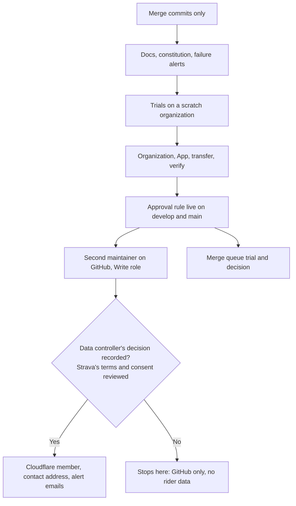

# Contract: `docs/maintainers.md` and the order of access

## Order

Nobody gets a step before the gate above it.

A GitHub Write role reaches no rider data: production secrets only reach runs on `main`, and those need the founding maintainer's approval. A Cloudflare role does reach rider data, through the D1 console.

## `docs/maintainers.md` sections

| Section | Content | Requirement |
|---|---|---|
| Who may do what | The spec's rights table, plus the Cloudflare result of trial T6 | FR-001 |
| The accepted limit | As in the spec | FR-002 |
| The stages | Current stage, the table, the steps to stage 2 | FR-030 |
| Billing, domain, spending | Decided by the founding maintainer; the move starts no payment | FR-012 |
| Strava owner only | Secret, app settings, Developer Program, webhook credentials, new team's secret | FR-016 |
| Credentials | [Credential record](../data-model.md) | FR-028 |
| Continuity | What keeps working, what waits, and the break-glass steps; the intention to support the Strava app for a prolonged period | FR-026 |
| Adding a maintainer | Steps below | FR-027 |
| Removing a maintainer | Steps below | FR-027 |
| Merge queue result | Recorded after the trial | FR-022 |

## Adding a maintainer

| Step | Who |
|---|---|
| Organization member, repository role Write, 2FA on | Owner |
| Add to `MAINTAINER_HANDLES` | Owner |
| Local setup in fake mode; `pnpm dev:strava` isn't for them | New maintainer |
| Access decision on record, and privacy page and consent changes done | Data controller |
| Cloudflare member with own login | Cloudflare member manager |
| Their address verified, added to the two mail secrets, if they handle rider requests | Any Cloudflare maintainer |

## Removing a maintainer

| Step | Who | If trust isn't assured |
|---|---|---|
| Remove from the organization | Owner | |
| Remove from Cloudflare | Cloudflare member manager | |
| Remove from `MAINTAINER_HANDLES` and both mail secrets | Remaining maintainer | |
| | Maintainer | Rotate `CLOUDFLARE_API_TOKEN`, the Release App's key and the Worker secrets they could reach |
| | Strava owner | Rotate the Strava secret |
| | Maintainer | Review merges and Cloudflare's deployment history |
| Update the access decision and privacy page if needed | Data controller | |

Rotations happen one at a time, and a re-deploy proves each, so production doesn't stop. The implementation lists what rotating each Worker secret does to riders, such as `SESSION_SIGNING_KEY` signing them out.

## Docs that change

`README.md`, `CLAUDE.md`, `.github/repository-settings.md`, `.github/rulesets/README.md` (FR-006, FR-029, FR-033), spec 002 (FR-024, FR-033) and `docs/architecture-and-collaboration.md`. `README.md`'s line about albums on "the maintainer's computer" becomes the data controller's (FR-021).

The old-owner path changes in the same pull request as the transfer, not before.
